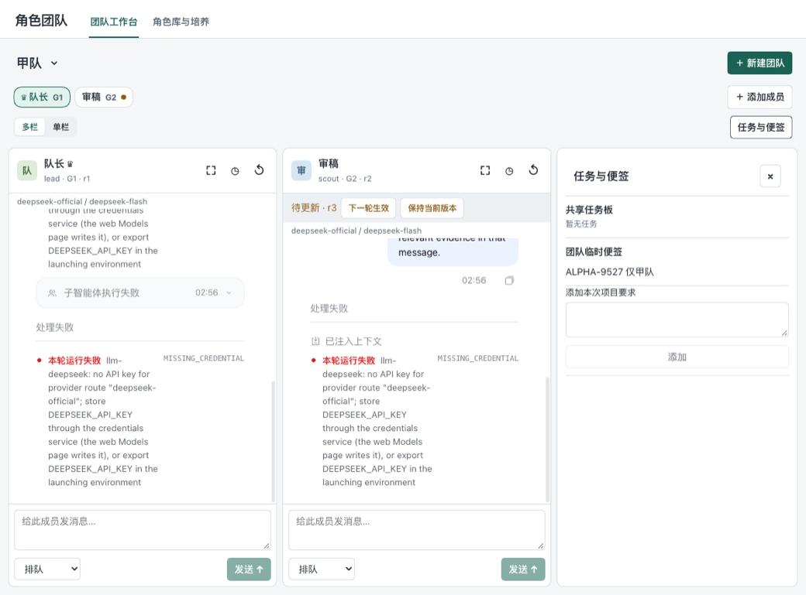
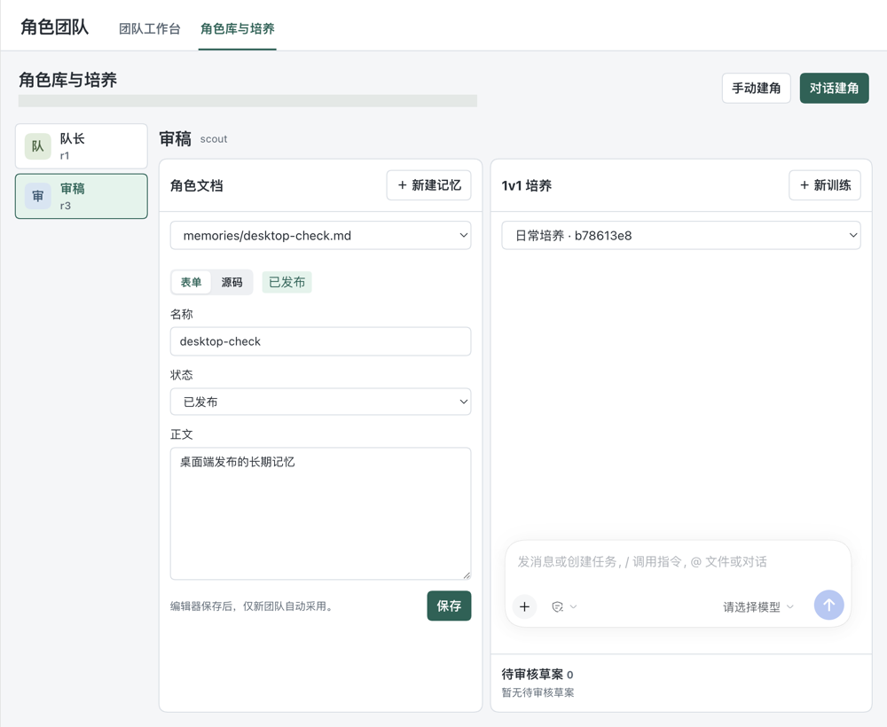

# Web 与 Electron Desktop 实机验收

2026-11-22，macOS 27.0.1（Apple Silicon）。同一份 `dsh-role-team@0.1.0` 安装包在 DSH 0.2.2-rc.5 的 Web 和 Desktop profile 上通过了安装、界面交互及冷启动恢复验收。两个席位的收件历史、代次和团队便签均可从真实界面核对。

**模型验证范围。** 启动环境未提供 `DEEPSEEK_API_KEY`，隔离凭据库也没有已配置的官方模型密钥。真实会话收到了成员直发消息，官方路由返回 `MISSING_CREDENTIAL`。真实模型生成回复、流式输出、运行中的 steer / 停止、模型触发审批和对话生成草案仍待配置 Key 后验证。自动化套件另行覆盖了草案审核和会话隔离。

## 2026-11-23 工作台与角色设定复验

在独立 Web profile 中用 Chrome 操作已打包的插件。检查了标题栏的拖动标识和按钮的非拖动区域，切换了三种角色视图，并从十个历史设定中恢复第 3 版，磁盘生成第 13 版。双成员团队在多栏模式并排展示两列，单栏模式的成员标签与操作按钮位于同一行。实测了团队列表折叠、展开、归档和队员菜单中的模型与推理档位选择。

模型请求发往本机测试服务。修改已入队角色的设定后，下一次请求携带了新设定，期间没有版本确认操作。DSH 会在已有会话的请求中追加更新后的系统消息，因此核验读取该请求最后生效的系统消息。测试没有调用付费模型。

本次构建通过类型检查和全部 38 项测试。正式 Desktop 和 Web 各自安装的 35 个文件与 tarball 逐字节一致，两端原有其他插件声明和用户 patch 核对通过。重启后确认桌面窗口已在前台。macOS 未授予测试进程模拟鼠标的权限，拖窗核验覆盖拖动区域与控件排除规则，未自动执行系统级鼠标拖拽。

## 三步安装使用

1. **制作安装包。** 安装 Node.js 24.9 或更高版本。在插件仓库运行 `npm ci`、`npm pack`，将生成的 `dsh-role-team-0.1.0.tgz` 放在固定目录。下面的 `/absolute/path/` 需换成该目录的实际绝对路径。
2. **安装到要用的 profile。** Web 停止 Host 后执行第一条命令，随后用同一 CLI 运行 `dsh web`。Desktop 先打开一次完成初始化，完全退出应用后执行第二条，再重新打开桌面应用。两端都要用时分别安装。macOS 上如果终端没有 `dsh` 命令，第一条和 Web 启动命令也可以使用第二条里的完整可执行文件路径。

   ```sh
   dsh plugin --profile web add "/absolute/path/dsh-role-team-0.1.0.tgz"
   "/Applications/DeepSeek Harness.app/Contents/Resources/runtime/cli/bin/dsh" plugin --profile desktop add "/absolute/path/dsh-role-team-0.1.0.tgz"
   ```

3. **建角并组队。** 从侧边栏打开「角色团队 → 角色库与培养」，点击「新建角色」，输入名称即可保存并开始聊天。要让角色或团队成员回复，先在宿主模型设置中配置 DeepSeek API Key。回到「团队工作台 → 新建团队」，填写已存在且与角色库分开的工作目录，选择队长与队员。设置中的「角色团队」显示当前角色库位置和下次启动的位置。

## 安装与加载证据

| 项目 | Web | Desktop |
| --- | --- | --- |
| 宿主与窗口 | 发布版 CLI 启动 `web`，绑定 `127.0.0.1`。Playwright 经 CDP 操作 Google Chrome 157.0.8103.80（headless） | 已安装的 macOS DeepSeek Harness.app 启动独立窗口和私有 Host。CDP 确认工作区 URL 为 `dsh-app://app/`，用户代理含 `Electron/44.7.0` |
| 隔离与安装 | 临时 `DSH_HOME`、工作目录、角色库和 Chrome 用户数据。随应用发布的 CLI 将本地 tarball 加入 Web profile | 同一个临时 `DSH_HOME`，独立 Electron `--user-data-dir`。完成 Desktop 初始化后，退出本次测试实例，用应用内置 CLI 安装到 Desktop profile |
| 配置与加载 | `web --dump-config` 出现 `role-team`、指定的 `roleStoreDir` 和 `role-team-preset`。侧边栏可打开 keyed 主面板，角色目录、读写和建队 RPC 均返回成功 | Desktop profile 记录本地 tarball，原生欢迎页选择「稍后配置」后进入工作区。验证主面板、原生设置、角色库路径及 RPC 写入。Desktop 由 Electron 独占启动 |
| 运行诊断 | 修复后重新加载和操作期间，CDP 未记录未捕获的页面异常或插件激活失败 | 工作区可见且可操作，重新加载和操作期间未观察到插件 Remote 错误或白屏。标准错误中出现过 macOS 对 Helper 资源的沙盒提示，随后窗口、读写与恢复均成功 |

交互测试使用修复后的客户端。更新 README 后重新打包，两端均重新安装最终 tarball 并复查主页面、团队状态和角色库。最终包共 35 个文件、103.9 kB，SHA-256 为 `e1d8e7a3c8c0d46f11a6bf19983824e11f533965e32c4d7d3f5b84714bff3202`。构建目录与两个 profile 实际加载的 `dist/client.js` 的 SHA-256 均为 `ed9d399b76a44eb41b329a1b39eed8575c5d5524b2bd87a6f2afbf7ac267e7dd`。

## 实际操作记录

| 操作 | 可复核结果 |
| --- | --- |
| Web 手动建角、外部保存 | 在 UI 创建并保存 `lead` 和 `scout`。从独立进程向 `scout/role.md` 追加一行后，快照由 `rev-0001.json` 增至 `rev-0002.json`，已运行的团队显示「待更新 · r2」 |
| Web 双团队隔离 | 甲队、乙队各有队长和审稿两列。甲队写入便签 `ALPHA-9527 仅甲队`，向审稿列发送 `ALPHA-WEB-DIRECT`。切换到乙队，抽屉显示「暂无临时便签」，页面中两项甲队标记均为零 |
| 版本生效 | 乙队点击「保持当前版本」，待更新提示消失。甲队可安排下一轮生效。后来发布 r3 后，甲队审稿席位在发送下一条消息前为 G2/r2，发送后为 G2/r3。新建丙队直接采用 G1/r3 |
| Web 换代与历史 | 甲队审稿席位提交交接摘要后从 G1 切换到 G2。G2 没有显示旧的直发标记；选择 G1 历史后可读到该标记，发送框数量为零。切回当前代后发送框恢复，单栏、双栏切换正常 |
| Web 冷恢复 | 停止并重新启动 Web Host，使用新启动链接重新进入。两队均可选择，甲队审稿仍为 G2，专属便签仍在 |
| Desktop 角色库与培养 | Electron 窗口能读到 Web 外部保存的角色正文。通过表单发布 `scout/memories/desktop-check.md`，创建独立训练会话并打开原生输入框 |
| Desktop 换代与重启 | 乙队审稿席位填写桌面交接摘要并换至 G2，在乙队写入 `BETA-DESKTOP 本队`。完整退出并重新启动本次 Electron 与其 Host 后，乙队 G2、便签、已发布记忆和原训练会话均恢复 |
| Desktop 路径设置 | 将测试角色库连同快照复制到新目录，在原生「设置 → 角色团队」中保存新路径。保存时界面仍显示原生效路径；重启后显示新路径，记忆和训练会话可读 |

截图取自实际测试窗口。桌面截图遮盖了测试机绝对路径，Web 截图保留了官方模型路由的缺少凭据提示。





## 修复与回归

- 首次使用发布版 Web 打开旧客户端时，宿主报告 `cannot get property "remote.settings" without inject`，插件未能激活。客户端现先挂载 Typert 描述符，等待 `remote.roleTeam` 服务后注册主页面，再在 `remote.settings` 的注入作用域内注册设置页。
- 打包回归测试使用 rc.5 发布的 SlotRegistry，在 Remote 命名空间延迟出现时验证主页面和设置页的注册顺序，并验证设置服务卸载时主页面仍可用。运行 `npm run typecheck`、`npm run build`、`npm test` 均成功，5 个测试文件、24 项用例全部通过。
- 初次用本地 DSH 源码工作区的构建物启动 Web 时，多个宿主包缺少生成的 Typert 模块。正式验收改用 rc.5 发布版完整运行时。测试未修改 DSH 源码，也未读取日常配置中的私有凭据。

## 对话优先的角色页与团队输入栏

在独立 Web profile 中使用发布版 rc.5 Host 和 Chrome 实际创建中文名角色、开启第二场对话、折叠角色档案并建立双列团队。两列均显示宿主的可编辑输入栏，子成员列显示跟随队长的权限和模型选择入口，过程中未捕获页面异常。隔离 profile 没有已配置的模型，此处仅验证选择入口。运行时集成测试使用可控适配器验证模型与推理档位跨会话、跨入队与重启恢复，另以原生权限服务验证运行中的成员、新入队成员跟随队长切换。

## 角色培养与经验录入（2026-11-23）

发布版 Web Host 与 Chrome 在独立 profile 中完成了建角、用一句话新增经验、修改经验、替换培养对话和删除经验。已核对磁盘上的经验状态为 published、重开对话后沙箱已更换、经验仍可见，操作期间无页面异常。运行时集成测试使用受控模型适配器，覆盖角色改写自身设定、记住和修正经验、替换旧会话后的上下文，以及中断后的归档恢复。此轮没有调用真实 DeepSeek 模型。
